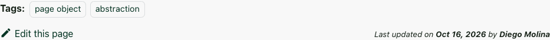
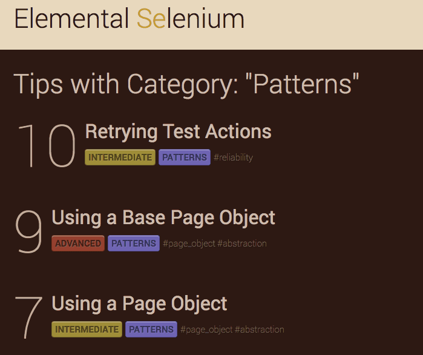
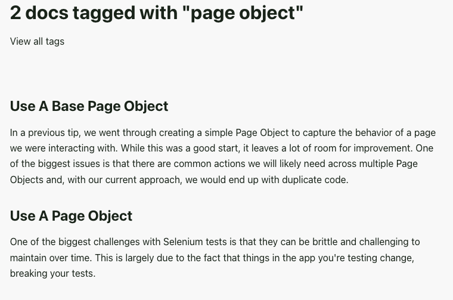

# How to Access Previous Tips

## Intro

Elemental Selenium started as a weekly newsletter, and over the years it collected dozens of tips. You found one
of them, but how do you find the others that are relevant to you?

## A Solution

Check out [the Elemental Selenium Tip Archives](/tips)! Each tip is available there, and it's simple to traverse.

All the tips are tagged, categorized, and marked by level of difficulty. Each marking is clickable (both
within the tip and when viewing all tips on the archive page), and will return a filtered result.

## Example

If you are viewing [Tip 7](/tips/7-use-a-page-object) and click on the category (e.g. 'Patterns').

Then it will return a list of all tips with the same category.

Alternatively, you could have clicked on one of the tags (e.g. '#page_object') and it would have returned a
list of tips that were tagged similarly.

## Expected Behavior

- View the tip archive (or an individual tip)
- Click a filtering option
- See a filtered list of tips
- View and enjoy another relevant tip

## Summary

Hopefully this has helped turn you onto the bounty of freely available Selenium tips that were right at your fingertips
this whole time.

Happy Testing!

## Authors

import DefaultAvatar from "@site/src/components/defaultAvatar";

<DefaultAvatar
    name="Dave Piacente"
    imgSrc={"https://github.com/tourdedave.png"}
    description={"Original creator of Elemental Selenium"}
    url={"https://github.com/tourdedave"}
    author={true}
/>

<DefaultAvatar
    name="Diego Molina"
    imgSrc={"https://github.com/diemol.png"}
    description={"Elemental Selenium maintainer"}
    url={"https://github.com/diemol"}
    author={true}
/>
